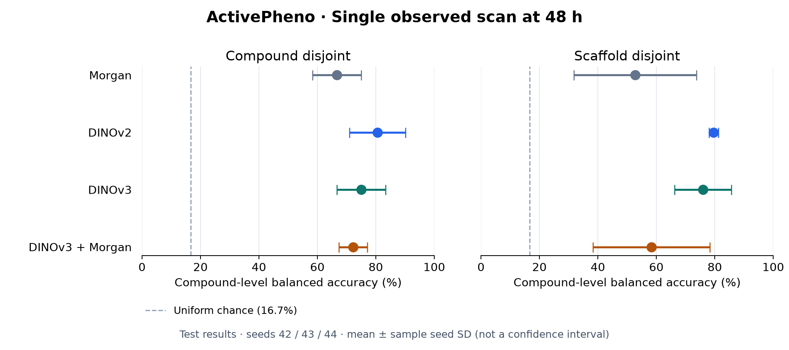
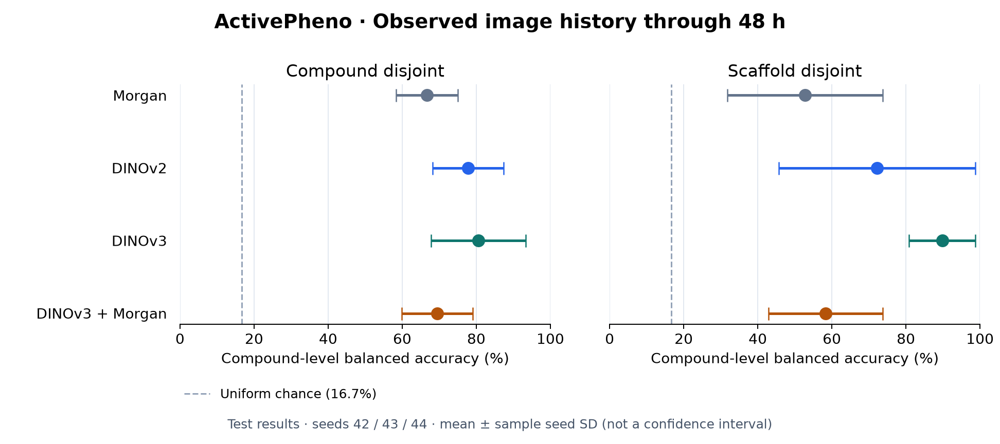

# Selected demonstration results

This directory contains selected demonstration results only. Full benchmark
tables, robustness analyses, and ablations are withheld pending manuscript preparation.

## LCTP at 48 h

Compound-level **test balanced accuracy**, mean ± sample SD across **all seeds
42/43/44**. Single-timepoint and observed-history conditions are separate;
Morgan has no temporal input. No best seed or best timepoint is selected.

### Single observed scan at 48 h

| Representation | Compound-disjoint BA (%) | Scaffold-disjoint BA (%) |
|---|---:|---:|
| Morgan | 66.7 ± 8.3 | 52.8 ± 21.0 |
| DINOv2 | 80.6 ± 9.6 | 79.6 ± 1.6 |
| DINOv3 | 75.0 ± 8.3 | 75.9 ± 9.8 |
| DINOv3 + Morgan | 72.2 ± 4.8 | 58.3 ± 20.0 |



### Observed image history through 48 h

Image features average the 25 acquired scans from 0 through 48 h before classification.

| Representation | Compound-disjoint BA (%) | Scaffold-disjoint BA (%) |
|---|---:|---:|
| Morgan | 66.7 ± 8.3 | 52.8 ± 21.0 |
| DINOv2 | 77.8 ± 9.6 | 72.2 ± 26.5 |
| DINOv3 | 80.6 ± 12.7 | 89.8 ± 8.9 |
| DINOv3 + Morgan | 69.4 ± 9.6 | 58.3 ± 15.5 |



Error bars show **seed SD, not confidence intervals**. Seeds overlap in compounds;
the small test cohorts are not independent biological replications. This is an
exploratory excerpt from previously inspected test sets, not a confirmatory
ranking of encoders. Fusion uses one standardized early-fusion baseline.

See the [protocol and limitations](lctp_48h_v1/PROTOCOL.md),
[aggregate CSV](lctp_48h_v1/metrics.csv), and
[artifact provenance](lctp_48h_v1/provenance.json).
The cohort uses complete matched feature availability through 68 h; this may
induce selection bias, even though model inputs stop at the stated endpoint.
Pooled evaluation uses all five plates and does not measure held-out-plate transfer.

## Rebuild the plots

```bash
python -m pip install -e '.[plots]'
python scripts/plot_demo_results.py
```

This regenerates the PNG and SVG figures from the released aggregate CSV. It
makes no network requests and does not refit classifiers. Core pipeline examples
are documented separately; the public CLI does not reproduce the historical
matched benchmark end to end.
